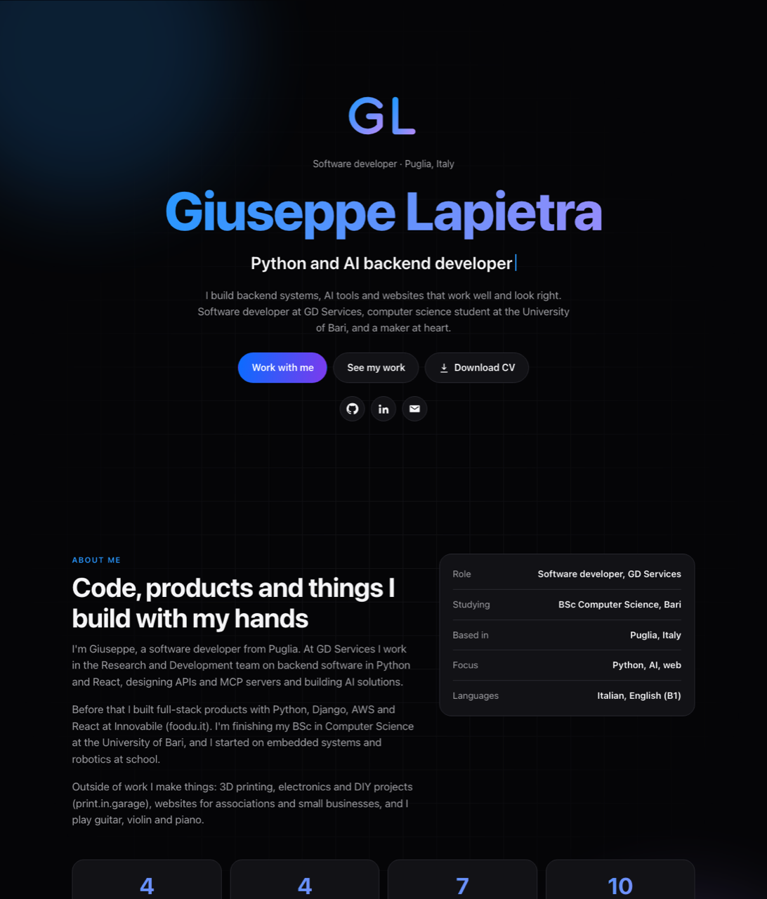

<div align="center">

# Giuseppe Lapietra – portfolio

**[peppe37.github.io](https://peppe37.github.io/)**

[](https://github.com/Peppe37/peppe37.github.io/actions/workflows/deploy.yml)
[](https://github.com/Peppe37/peppe37.github.io/actions/workflows/links.yml)
[](LICENSE)



</div>

My personal portfolio: who I am, what I have built (websites for other people, my own products, open source) and my CV, in English and Italian.

It is one static page with no framework and no build step: HTML, CSS and a little JavaScript. A pipeline checks it and publishes it to GitHub Pages on every push to `main`.

## What it does

- **Two languages.** English by default; the page follows the visitor's system language when it is Italian, and the EN/IT switch remembers the choice. A link can force one: [`/?lang=it`](https://peppe37.github.io/?lang=it).
- **Light and dark** follow the system. Animations stop for visitors who ask for reduced motion.
- **Live data.** The stars on the open-source cards are read from the GitHub API (one request, cached for an hour). Everything else works without it.
- **Downloadable CV** in both languages, generated from the data in [`scripts/build_cv.py`](scripts/build_cv.py).

## Layout

```
site/                  everything that is published
  index.html           the page (both languages are in js/i18n.js)
  css/style.css
  js/main.js           behaviour: language, animations, stars
  js/i18n.js           all the texts, English and Italian
  assets/              logo, social image, project screenshots
  404.html  robots.txt  sitemap.xml
scripts/
  build_cv.py          builds the two CV PDFs with headless Chrome
  check_site.py        checks the site before it goes out
.github/
  workflows/           ci.yml, deploy.yml, links.yml
  dependabot.yml       keeps the actions up to date
lighthouserc.json      score thresholds for Lighthouse
docs/preview.png       the picture above
```

## Working on it

Needs Python 3 and, for the CV, Google Chrome or Chromium.

```sh
python3 scripts/build_cv.py              # makes the CV PDFs (they are generated, not committed)
python3 -m http.server -d site 8000      # then open http://localhost:8000
python3 scripts/check_site.py --cv       # the same checks CI runs
```

**Changing a text:** edit it in `site/js/i18n.js`, in both languages. A text that is in the page needs its key (`data-i18n="..."`) in both dictionaries; `check_site.py` fails if one is missing or unused.

**Adding a project:** copy a card in `site/index.html`, add a screenshot to `site/assets/shots/` (a JPEG under 400 KB) and its texts to `i18n.js`.

**Changing the CV:** edit the data at the top of `scripts/build_cv.py`. Each PDF has to stay on one page; the check enforces it.

## Pipeline

| Workflow | When | What it does |
| --- | --- | --- |
| **CI** (`ci.yml`) | pull requests, and before every deploy | JavaScript syntax, HTML validation, builds the CV PDFs, runs `check_site.py` (translations, local links, no phone number or placeholder text, size budgets, one page per CV), and Lighthouse (performance, accessibility, best practices and SEO above 85-90) |
| **Deploy** (`deploy.yml`) | push to `main`, or by hand | runs the checks, builds the CV into the site and publishes `site/` to GitHub Pages. If a check fails nothing is published |
| **Links** (`links.yml`) | every Monday | checks that the external links answer, and opens an issue if some don't |

GitHub Pages is set to **Source: GitHub Actions** (Settings → Pages). The CV PDFs only exist in the published site, not in the repository.

## License

The **code** (HTML, CSS, JavaScript, scripts, workflows) is MIT: see [LICENSE](LICENSE). The **content** (texts, CV, logo, photos) is mine and all rights are reserved: see [CONTENT_LICENSE.md](CONTENT_LICENSE.md). The screenshots show other people's sites, which belong to their owners.
